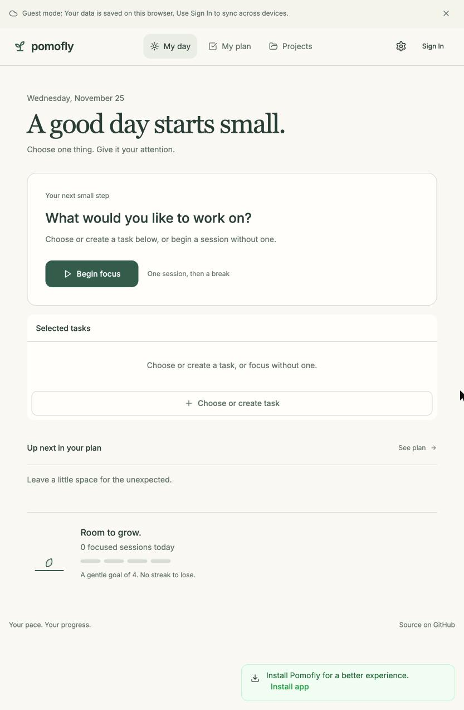
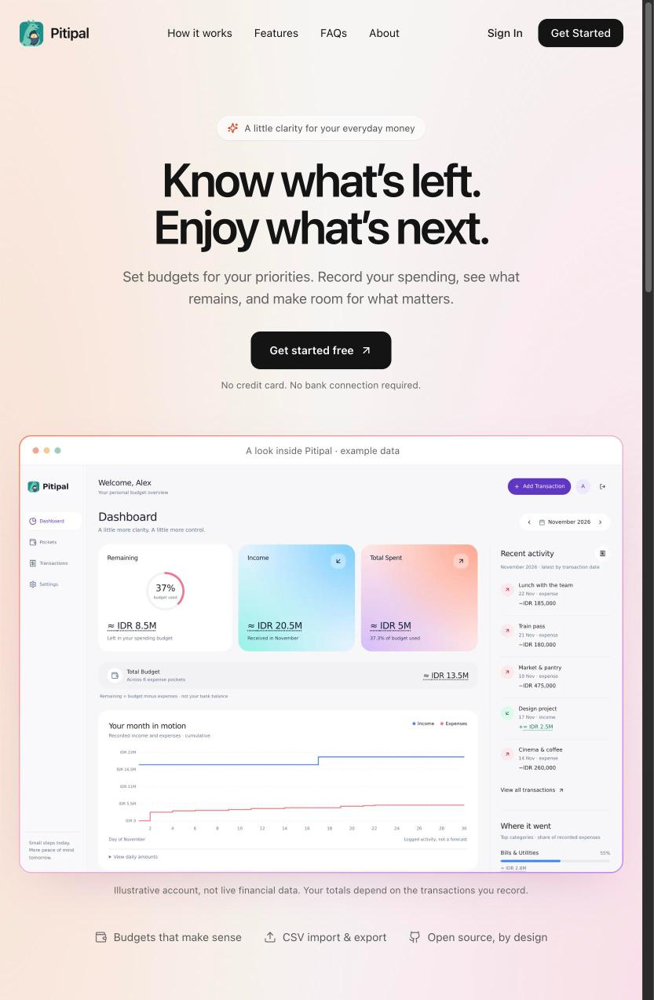

# Hi, I'm Arief 👋

**Technical Product Manager · Fullstack & AI Engineer · Founder of [Codekarsa](https://www.codekarsa.com)**

I turn messy problems into calm, useful products, from the PRD to the production deploy.

---

## ✨ Featured projects

<table>
<tr>
<td width="50%" valign="top">

### 🌱 [Pomofly](https://pomofly.codekarsa.com)

A calm Pomodoro focus app built around **one small next step**. Pick a task, focus, take a break, and keep a gentle daily goal with no streak to lose.

- ⏱️ Focus sessions with breaks, a daily plan and projects
- ☁️ Guest mode, then sync across devices after sign-in
- 📲 Installable as an app

`Next.js` `TypeScript` `Firebase` `Tailwind CSS` `Anthropic SDK`

**[Try it live →](https://pomofly.codekarsa.com)** · [Source](https://github.com/Codekarsa/pomofly)

</td>
<td width="50%" valign="top">

### 💸 [Pitipal](https://pitipal.codekarsa.com)

A simple, open-source budgeting app: **know what's left, enjoy what's next**. Split your budget into pockets, record spending and see what remains at a glance.

- 👛 Budget pockets that repeat monthly, with rollover
- 📊 Income kept separate from spending, clear charts
- 📁 CSV import and export, no bank connection needed

`React` `Vite` `TypeScript` `Supabase` `PostgreSQL` `Recharts`

**[Try it live →](https://pitipal.codekarsa.com)** · [Source](https://github.com/Codekarsa/pitipal)

</td>
</tr>
</table>

---

## 🧭 What I work on

- 🤖 **AI products:** multi-agent orchestration and LLM cost optimisation (prompt caching, routing between model tiers)
- 🔄 **Automation:** CRM and workflow systems with GoHighLevel, n8n and Retell AI
- 🇮🇩 **Products for Indonesian SMEs:** POS, bookkeeping and WhatsApp-first experiences
- 📦 **Previously:** Lead PM for Logee Fulfillment at Telkom Indonesia (IDR 48B annual GMV), plus Ever Technologies and Rata.id

## 🛠️ Toolbox

---

💬 Building something with AI or automation? **[Let's talk.](mailto:arief.gusti@gmail.com)**

